University: [ITMO University](https://itmo.ru/ru/)  
Faculty: [FTMI](https://ftmi.itmo.ru/)  
Course: [Введение в веб технологии](https://itmo-ict-faculty.github.io/introduction-in-web-tech/)  
Year: 2026/2027  
Group: U4225<br>
Author: Peshkov Andrey Konstantinovich<br>
Lab: Lab1<br>
Date of create: 02.11.2026  

# Лабораторная работа № 1

## Обзор Google Cloud и исследование основных сервисов

### Цель работы

Ознакомиться с основными возможностями облачной платформы Google Cloud, создать сервисный аккаунт и виртуальную машину, а также исследовать доступ к объектам Cloud Storage при изменении роли аккаунта.

### Ход работы

#### 1. Создание сервисного аккаунта

В проекте `cloud-platforms-as-the-basis` создан сервисный аккаунт `apeshkov-sa-lab1`. На этапе создания ему назначена роль **Storage Admin**, предоставляющая права управления ресурсами Cloud Storage.

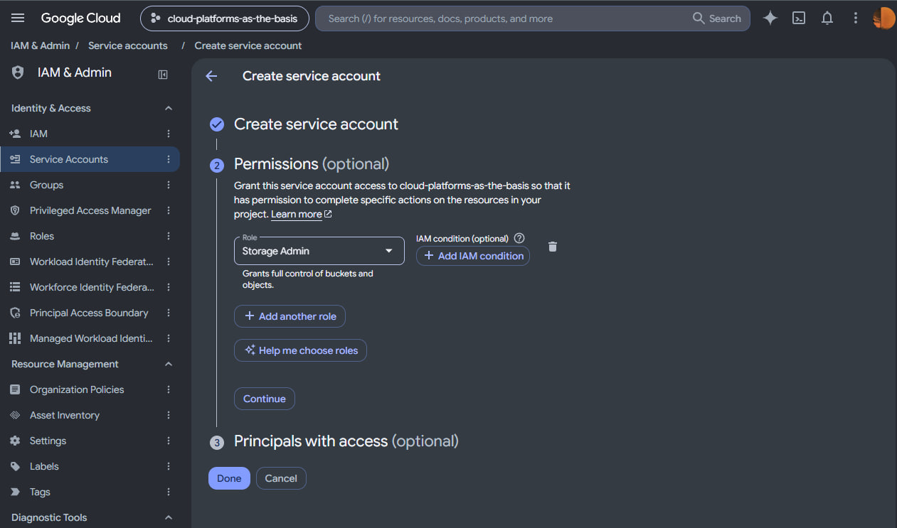

*Рисунок 1 — Назначение роли Storage Admin сервисному аккаунту.*

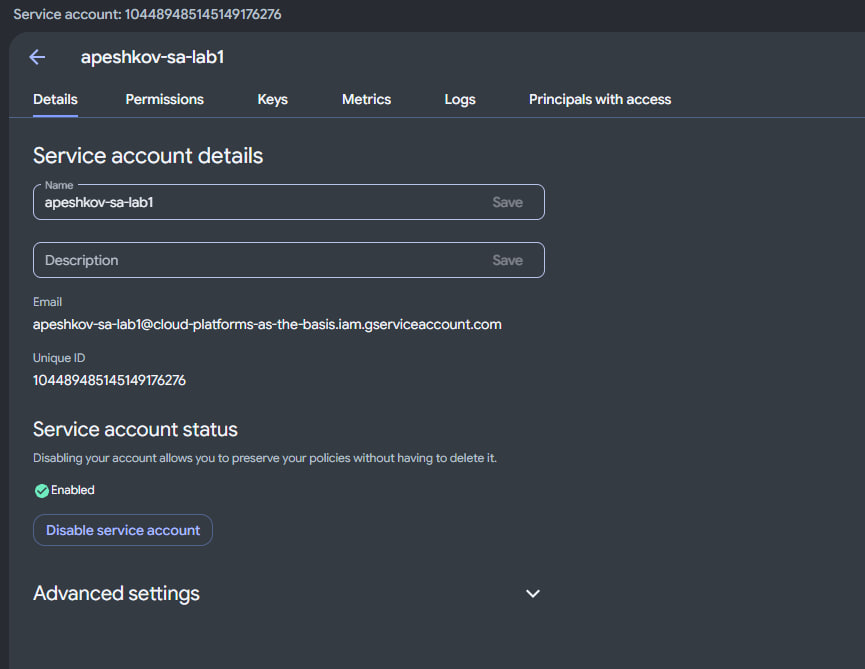

*Рисунок 2 — Созданный сервисный аккаунт apeshkov-sa-lab1.*

#### 2. Создание виртуальной машины

В Compute Engine создана виртуальная машина `apeshkov-vm-lab1` со следующими параметрами:

- тип машины — `e2-micro`;
- режим — Spot;
- зона — `us-central1-a`;
- операционная система — Debian GNU/Linux 13;
- сервисный аккаунт — `apeshkov-sa-lab1`;
- область доступа API — Allow full access to all Cloud APIs.

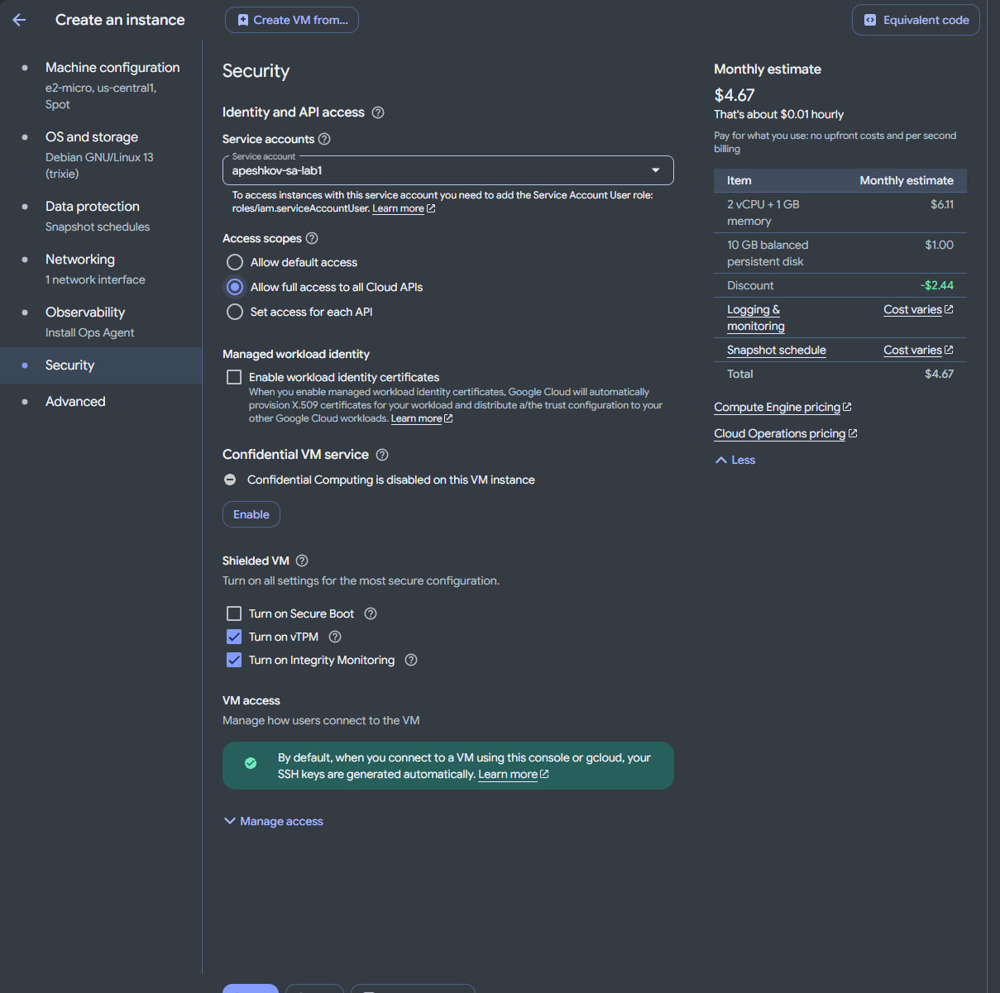

*Рисунок 3 — Настройка Spot VM и подключение сервисного аккаунта.*

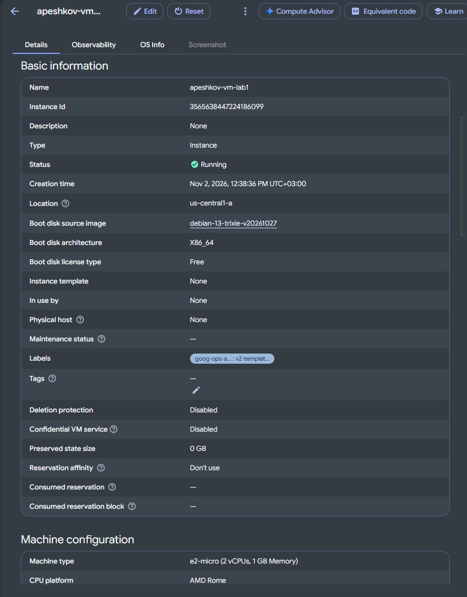

*Рисунок 4 — Параметры запущенной виртуальной машины.*

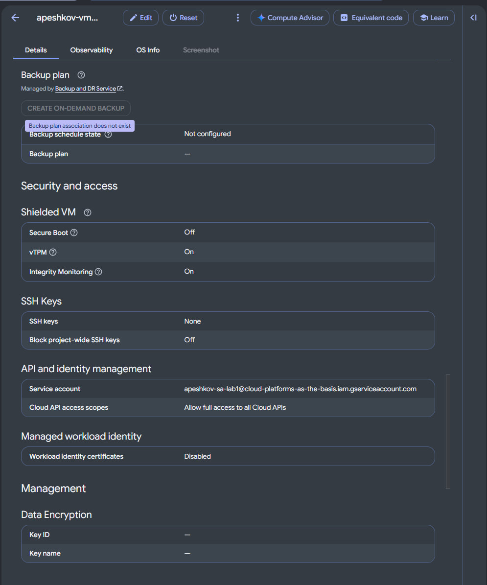

*Рисунок 5 — Подключённый сервисный аккаунт и область доступа API.*

#### 3. Копирование файлов из Cloud Storage

К виртуальной машине выполнено подключение по SSH. С помощью утилиты `gcloud` проверена версия Google Cloud CLI и просмотрено содержимое бакета:

```bash
gcloud version
gcloud storage ls gs://lab1-bucket-itmo
```

В бакете обнаружены файлы `pic1.jpg`, `pic2.jpg` и `pic3.jpeg`.

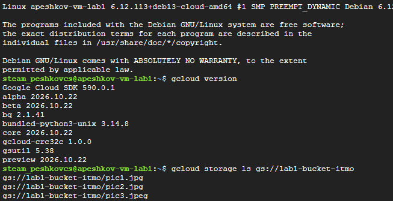

*Рисунок 6 — Проверка gcloud и просмотр содержимого бакета.*

Для файлов создана локальная папка на виртуальной машине. После копирования её содержимое проверено командой `ls -lah`:

```bash
mkdir -p ~/lab1-files
gcloud storage cp gs://lab1-bucket-itmo/pic1.jpg gs://lab1-bucket-itmo/pic2.jpg ~/lab1-files/
gcloud storage cp gs://lab1-bucket-itmo/pic3.jpeg ~/lab1-files/
ls -lah ~/lab1-files
```

При первой попытке для третьего файла ошибочно было указано расширение `.jpg`. После исправления на `.jpeg` файл успешно скопирован. В выводе `ls -lah` отображаются все три файла.

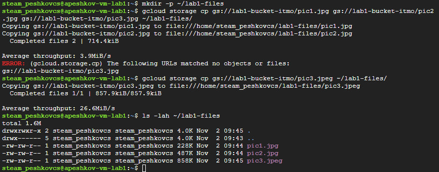

*Рисунок 7 — Копирование объектов и проверка файлов на виртуальной машине.*

#### 4. Изменение роли и повторная проверка

Для сервисного аккаунта роль **Storage Admin** заменена на **Compute Viewer**. На рисунке показан экран изменения ролей перед сохранением.

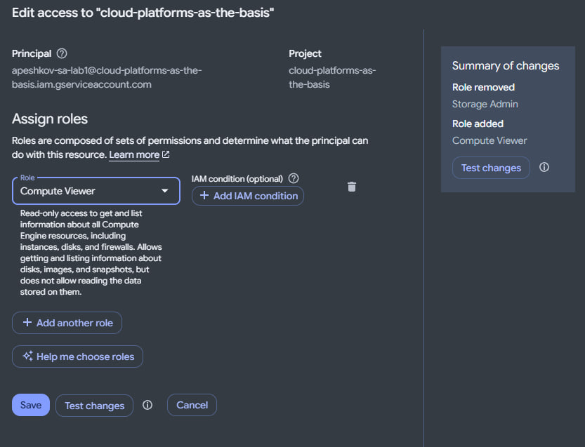

*Рисунок 8 — Удаление роли Storage Admin и добавление роли Compute Viewer.*

После сохранения изменений повторно выполнено копирование файла:

```bash
mkdir -p ~/lab1-retry
gcloud storage cp gs://lab1-bucket-itmo/pic1.jpg ~/lab1-retry/
```

Копирование завершилось успешно. Для проверки публичной доступности объекта выполнен HTTP-запрос без учётных данных:

```bash
curl -I https://storage.googleapis.com/lab1-bucket-itmo/pic1.jpg
```

Ответ `HTTP/2 200` показал, что объект `pic1.jpg` доступен без авторизации. Аналогичная проверка двух других файлов также вернула HTTP 200. Поэтому на этих публичных файлах нельзя продемонстрировать запрет чтения после смены роли. Наличие публичного доступа объясняет, почему отсутствие роли Storage Admin не обязательно препятствует скачиванию; отдельно проверить другие возможные разрешения аккаунта на бакет в ходе работы не удалось.

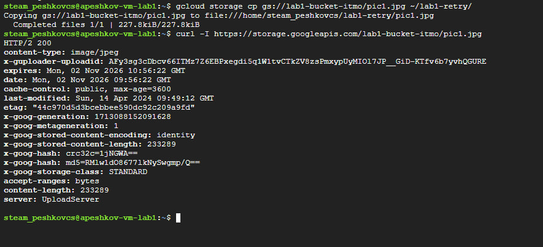

*Рисунок 9 — Успешное повторное копирование и ответ HTTP 200 на запрос без авторизации.*

#### 5. Удаление ресурсов

После завершения работы виртуальная машина `apeshkov-vm-lab1` удалена. В окне подтверждения указано, что вместе с ней удаляется загрузочный диск; после удаления проверено отсутствие диска в списке. Для сервисного аккаунта `apeshkov-sa-lab1` открыто окно подтверждения удаления.

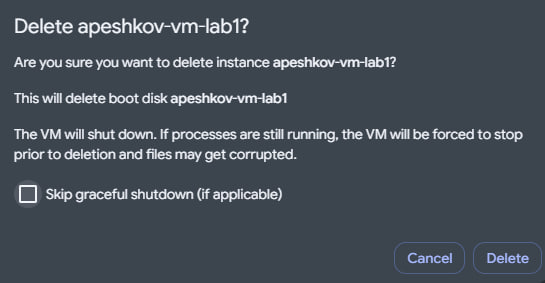

*Рисунок 10 — Подтверждение удаления виртуальной машины и её загрузочного диска.*

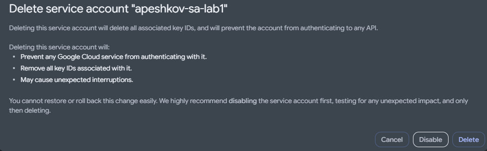

*Рисунок 11 — Окно подтверждения удаления сервисного аккаунта.*

### Вывод

В ходе работы исследованы сервисы IAM, Compute Engine и Cloud Storage. Создан сервисный аккаунт, развёрнута Spot VM типа `e2-micro` и три объекта скопированы из бакета на её диск. После замены роли Storage Admin на Compute Viewer повторное копирование осталось доступным. Проверка без авторизации показала, что файлы публичны, поэтому по этому эксперименту нельзя сделать вывод о запрете доступа к закрытым объектам Cloud Storage. Виртуальная машина и её диск удалены; для сервисного аккаунта выполнен переход к подтверждению удаления.
