University: [ITMO University](https://itmo.ru/ru/)  
Faculty: [FTMI](https://ftmi.itmo.ru/)  
Course: [Cloud platforms as the basis of technology entrepreneurship] 
Year: 2026/2027  
Group: U4225 
Author: Peshkov Andrey Konstantinovich 
Lab: Lab2 
Date of create: 02.11.2026  

# Лабораторная работа № 2

## Исследование Cloud Run

### Цель работы

Ознакомиться с работой Cloud Run: развернуть сервис, проверить его работу, изучить логи и метрики, изменить настройки контейнера и распределить трафик между ревизиями.

### Ход работы

#### Создание сервиса

В проекте cloud-platforms-as-the-basis создан сервис Cloud Run с именем apeshkov-lab2 в регионе europe-west1. Для него выбран готовый контейнер Hello по адресу us-docker.pkg.dev/cloudrun/container/hello. Включён публичный доступ и выбран режим оплаты Request-based.

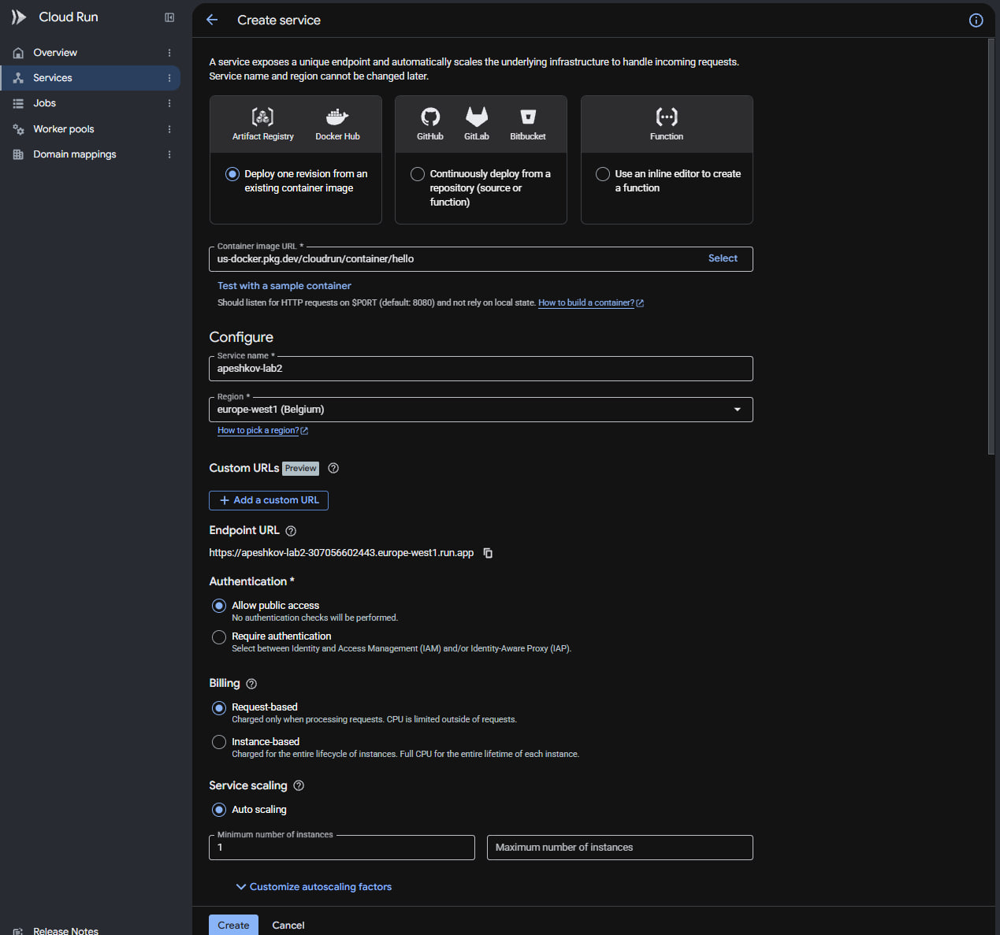

Рисунок 1 — Выбор образа и настройка сервиса. На скриншоте показаны настройки до создания; минимум экземпляров на уровне сервиса позже был изменён.

Для контейнера установлены 128 MiB памяти, 0,08 CPU, порт 8080, среда First generation и один одновременный запрос на экземпляр. Ускорение CPU при запуске отключено.

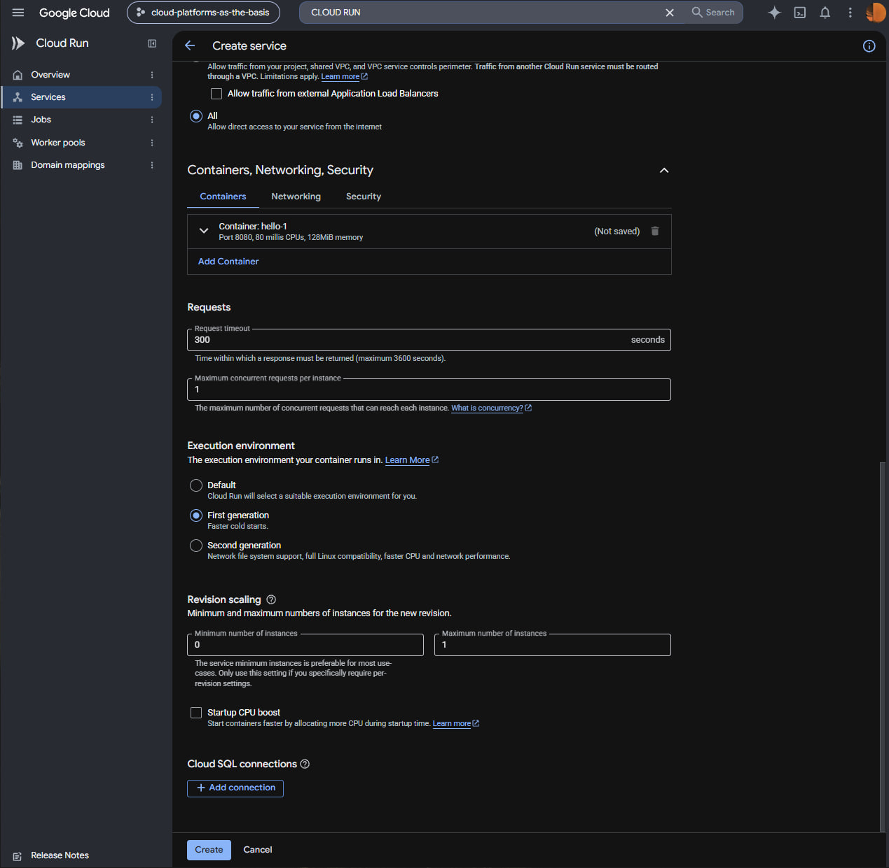

Рисунок 2 — Настройка ресурсов и среды выполнения.

После создания сервис и первая ревизия apeshkov-lab2-00001-hpz успешно запустились. На странице ревизии отображались порт 8080 и выбранные ресурсы.

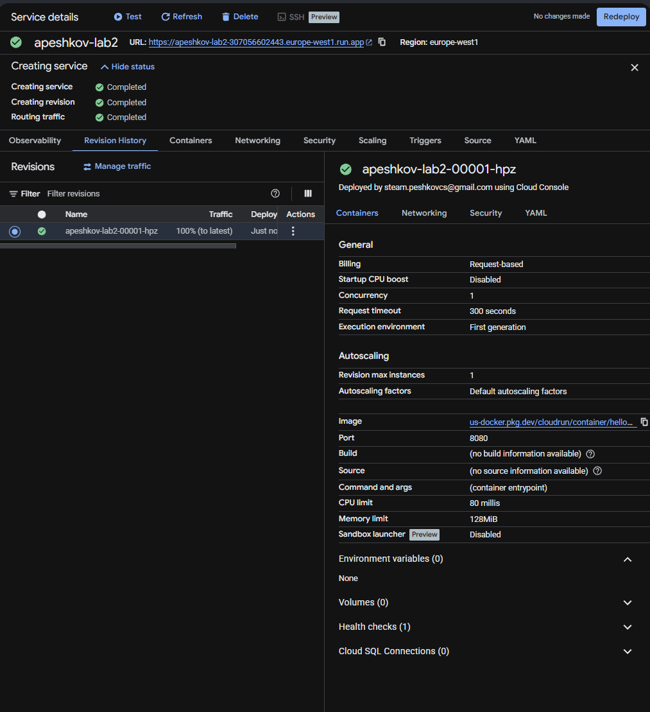

Рисунок 3 — Параметры первой ревизии.

#### Проверка сервиса

По URL сервиса открыта страница Hello с сообщением «It's running!». На странице указано имя первой ревизии.

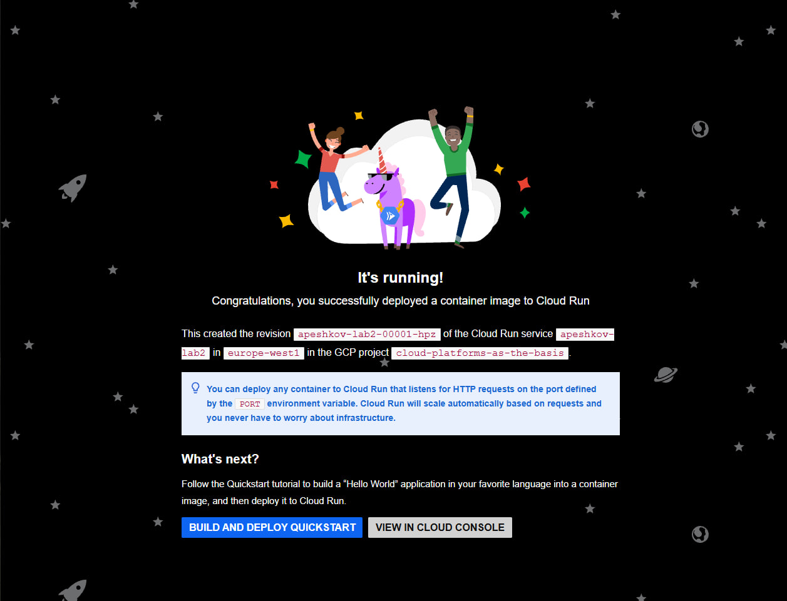

Рисунок 4 — Страница работающего сервиса.

#### Логи и метрики

В разделе Logs обнаружены сообщения об успешном запуске контейнера и проверке порта 8080. После открытия страницы появились записи HTTP GET с кодом ответа 200.

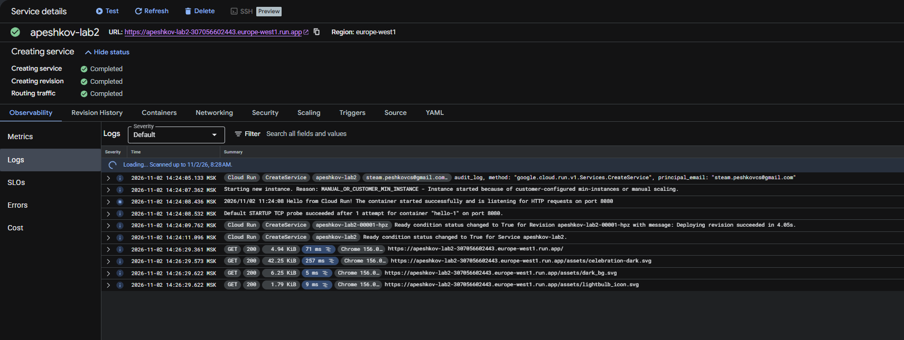

Рисунок 5 — Журнал запуска и запросов.

В разделе Metrics отображались количество успешных запросов, задержка, число экземпляров, а также использование CPU и памяти. Наблюдений было немного, поскольку сервис только что создан и нагрузка была небольшой.

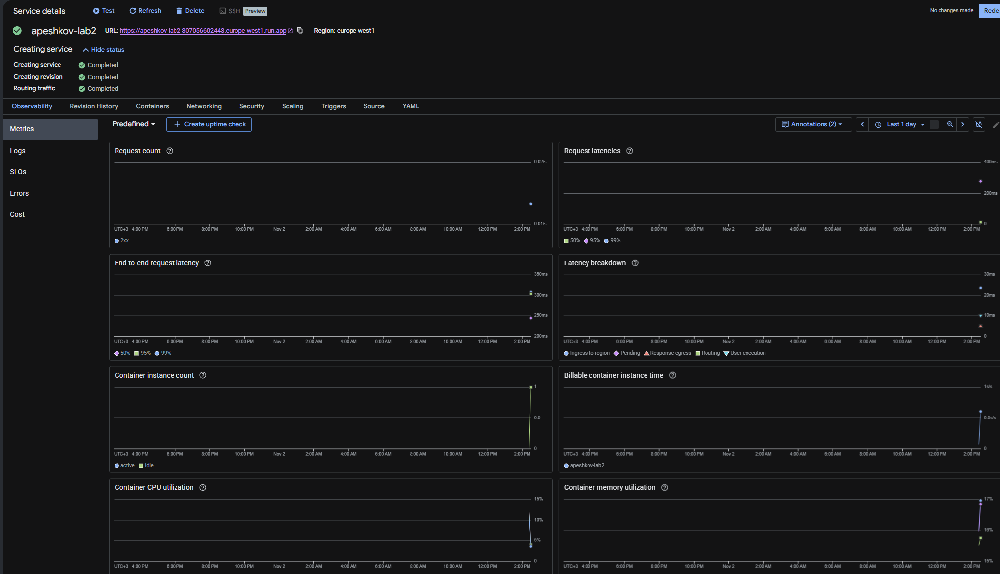

Рисунок 6 — Метрики запросов и ресурсов.

#### Изменение масштабирования и порта

При проверке оказалось, что минимум на уровне сервиса установлен в 1, а максимум — в 100. Настройки изменены: минимум установлен в 0, максимум — в 1. Параметр одновременных запросов оставлен равным 1.

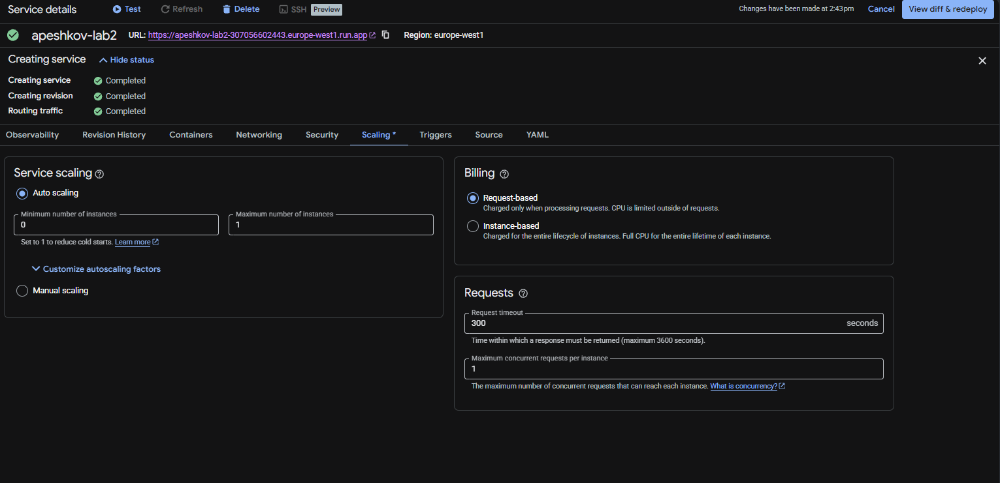

Рисунок 7 — Новые настройки масштабирования перед применением.

Затем порт контейнера изменён с 8080 на 8090 и выполнено развёртывание новой ревизии.

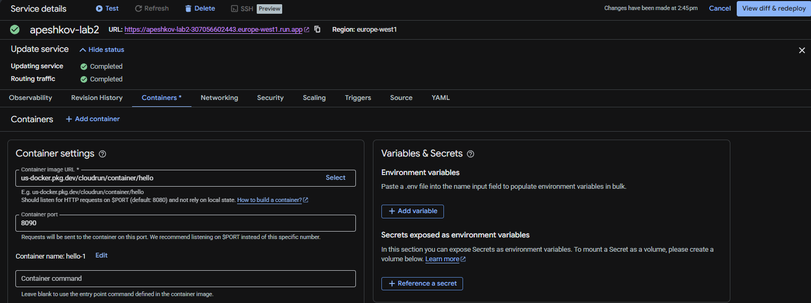

Рисунок 8 — Изменение порта контейнера на 8090.

После изменения сервис продолжил открываться. На странице отображалась новая ревизия apeshkov-lab2-00002-tzz. Следовательно, смена порта в данном эксперименте не привела к недоступности сервиса; контейнер смог работать с новым значением порта.

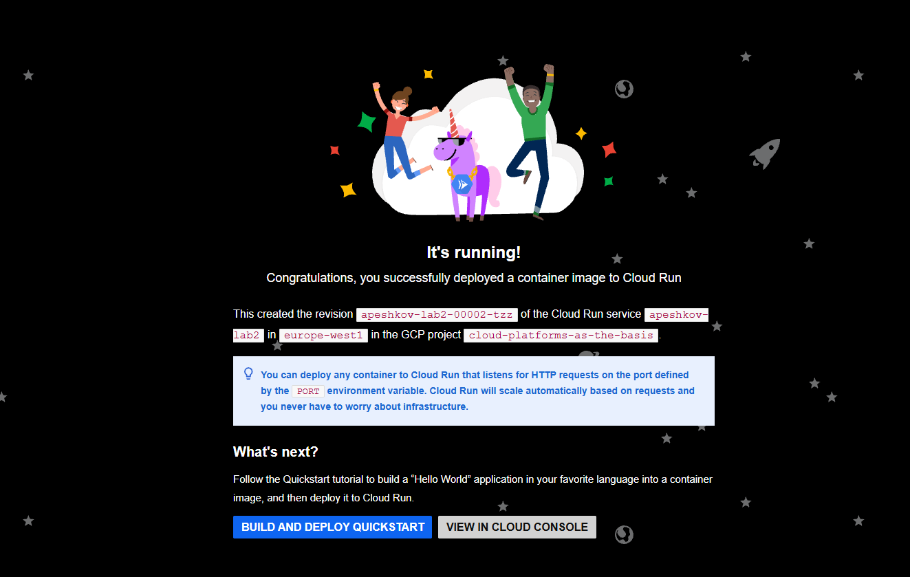

Рисунок 9 — Работа сервиса после изменения порта.

#### Переключение трафика

С помощью Manage traffic весь трафик сначала направлен на первую ревизию. После обновления страницы на ней снова отобразилось имя apeshkov-lab2-00001-hpz.

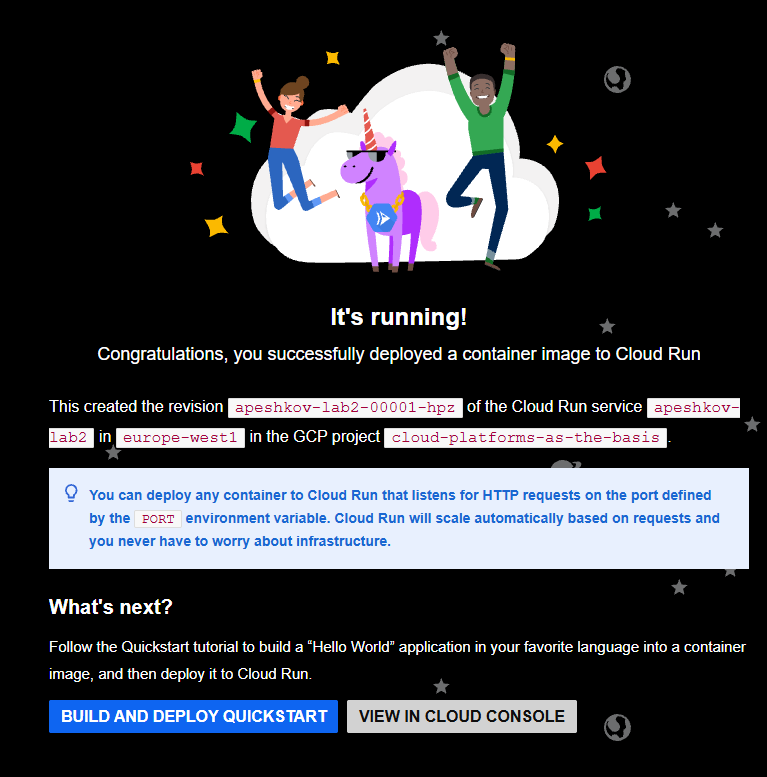

Рисунок 10 — Первая ревизия после переключения трафика.

При попытке разделить трафик между двумя ревизиями возникла ошибка: максимум экземпляров на уровне сервиса был равен 1, хотя для двух ревизий, получающих трафик, требовалось значение не меньше 2.

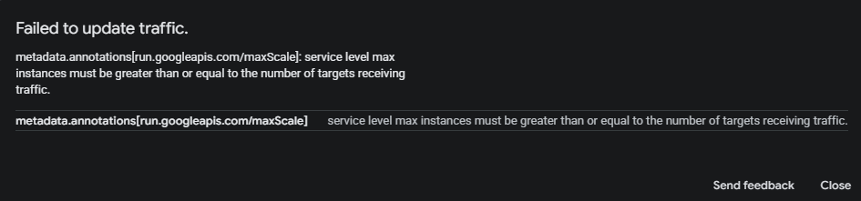

Рисунок 11 — Ошибка при ограничении максимума одним экземпляром.

Максимум экземпляров увеличен до 2. После этого трафик распределён между двумя ревизиями поровну — по 50%. При повторных обновлениях страницы отображались разные имена ревизий; обе показывали страницу Hello.

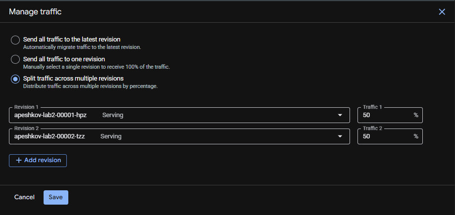

Рисунок 12 — Настройка распределения трафика между ревизиями по 50%.

#### Удаление сервиса

После завершения эксперимента сервис apeshkov-lab2 удалён. На рисунке показано окно подтверждения удаления.

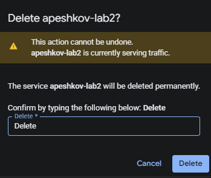

Рисунок 13 — Подтверждение удаления сервиса Cloud Run.

### Вывод

В ходе работы развёрнут и проверен сервис Cloud Run на основе стандартного контейнера Hello. Изучены логи и метрики, изменён порт контейнера с 8080 на 8090, а трафик переключён и распределён между двумя ревизиями. Обе ревизии продолжили отвечать. При ограничении сервиса одним экземпляром разделение трафика между двумя ревизиями завершилось ошибкой; после увеличения максимума до двух распределение удалось настроить. По окончании работы сервис удалён.
